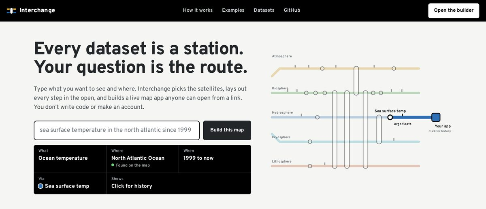
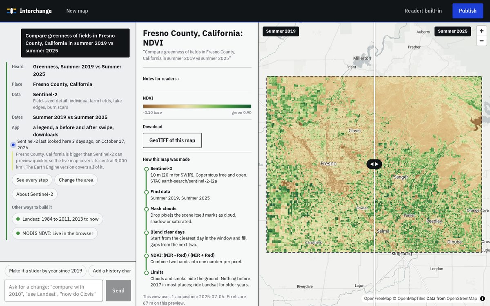
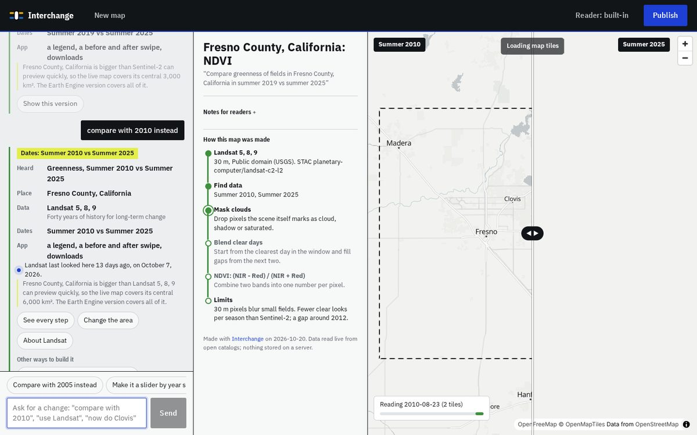
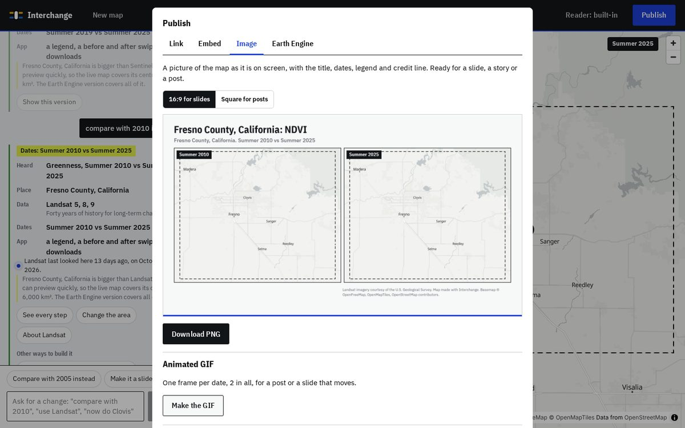
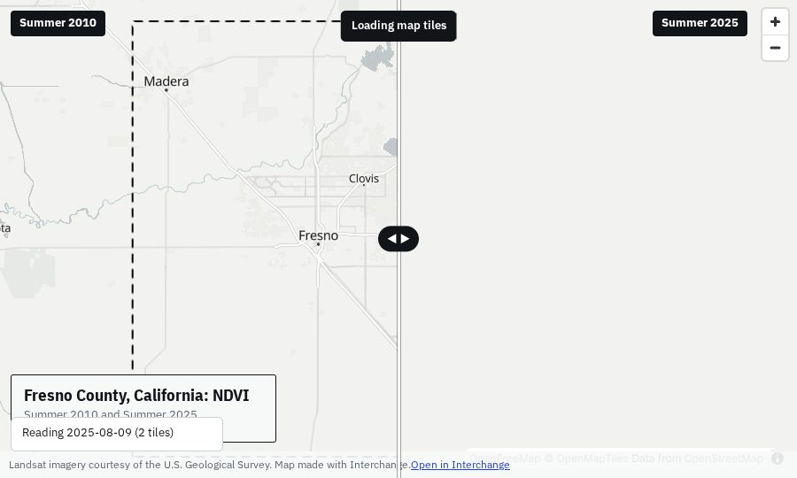

# Interchange

**Ask the planet a question in plain words. Get a satellite map you can publish as a link, an embed or a slide.**

Try it: **[shourya0mehta.github.io/interchange](https://shourya0mehta.github.io/interchange/)**. Type a question on the home page and press Build this map, or open the studio and start from a job.

Interchange is a prompt-to-app builder for Earth observation, a Base44 for satellite maps. You write one sentence ("compare greenness of fields in Fresno County, summer 2019 vs summer 2025") and the studio builds a live map app straight away, showing each step it took: the place it found, the dataset it chose and why, the dates and the method. You refine it by asking ("compare with 2010 instead", "use Landsat", "zoom out", "add a history chart where I click"); every version stays one click away. When it's right, Publish gives you a link that holds the whole app, an embed with the data provider's credit line, a 16:9 or square image with legend and credits, an animated GIF for apps with several dates, or the Earth Engine script. Several maps can be strung into a **journey**: a scrolling story with a caption at each stop, where the map changes as the reader reaches it.

Everything runs in the browser on open data. There is no server, no account and no compute bill.



| The studio: a question becomes a running app | Ask for a change: older years move it to Landsat |
| --- | --- |
|  |  |
| **Publish: a slide image with legend and credits** | **Embed: the map inside a story, with its credit line** |
|  |  |

## Who it's for

Research into who builds simple satellite map apps (see DECISIONS.md) pointed at three jobs:

- **Newsrooms**: a credible satellite visual for today's story without a GIS desk. Embed code sized for phones, the credit line in each provider's wording, a methods note, and images for social.
- **Classrooms**: a link students open with no accounts, with questions to explore beside the map, history on click and CSV that opens in Sheets.
- **Field offices** (extension and crop advisors): this season against past ones, county by county, with area totals and a slide image.

## How it works

```
sentence ─▶ intent ─▶ place ─▶ candidate routes ─▶ type check ─▶ app spec ─▶ live app ─▶ link / embed / image
   ▲                                                                              │
   └──────────── follow-up request: only what it mentions changes ◀───────────────┘
```

1. **Read the question, and say what was heard.** A rule-based reader pulls out the theme, the place, the dates and the app shape. It doesn't depend on capital letters: a vocabulary of non-place words, a gazetteer of oceans, seas and big regions, coordinates in several notations ("lat 36.7 lon -119.8"), named disasters ("hurricane harvey" brings its month and city), misspellings, "right now", "in July", "hotter than", "shrinking". The sign under the question reads it back as you type, letter by letter like a departure board, and the globe turns to the place. With an Anthropic API key, Claude Haiku reads the question instead.
2. **Plan routes.** Each theme has candidate datasets in order of fit. The planner fits the dates to each dataset's record (Sentinel-2 can't see 2010, so the route transfers to Landsat), ranks by how much of the place and the dates each covers, and keeps the others as "other ways to build it".
3. **Type-check and compile.** A route is a typed program; a swipe needs exactly two windows, a history chart needs a dataset that changes over time. The route becomes an `AppSpec` small enough to live in the URL.
4. **Run.** The runtime searches STAC catalogs (Earth Search, Planetary Computer), reads only the COG windows it needs at an overview matched to the screen, masks clouds with each scene's own classification, blends up to three clear days, computes the index, reprojects into a Web Mercator grid and draws it under MapLibre's labels. New pixels arrive under a scan line, and a probe under the cursor reads out the value there.
5. **Refine.** A follow-up request changes only what it mentions (dates, place, dataset, view or zoom) and rebuilds.
6. **Publish.** A link, an embed (`#embed=`), a PNG drawn from the map canvases with title, dates, legend and credit line, an animated GIF with one frame per date, an Earth Engine script, or a journey (`#journey=`) of several maps with captions.
7. **Your own boundary.** Upload a GeoJSON or KML field or district, and the map, its area totals and its GIF are masked to it.

## What it can answer today

Fifteen datasets run live in the browser:

| Station | Reads | Signals | Live preview covers |
| --- | --- | --- | --- |
| Sentinel-2 L2A | Earth Search | true color, NDVI, NDWI, MNDWI, NBR, NDSI, NDMI, NDBI | 3,000 km² |
| Landsat 5, 8, 9 Collection 2 L2 (Tier 1) | Planetary Computer | same as Sentinel-2, back to 1984 | 6,000 km² |
| Sentinel-1 RTC | Planetary Computer | radar backscatter (floods through clouds) | 3,000 km² |
| MODIS 16-day NDVI | Planetary Computer | greenness since 2000 | 400,000 km² |
| MODIS land surface temperature (MOD11A2) | Planetary Computer | daytime ground temperature since 2000 | 1,000,000 km² |
| MODIS snow cover (MOD10A2) | Planetary Computer | share of weeks with snow on the ground | 250,000 km² |
| MODIS active fire (MOD14A2) | Planetary Computer | share of 8-day periods with a fire | 400,000 km² |
| NOAA OISST v2.1 | Planetary Computer | daily sea surface temperature and its anomaly, 1981 to now | a whole ocean |
| NOAA NClimGrid (US) | Planetary Computer | monthly rain and air temperature, 1895 to 2022 | the lower 48 |
| USDA Cropland Data Layer (US) | Planetary Computer | crop type by 30 m field, 2008 to 2021 | 15,000 km² |
| ESA CCI land cover | Planetary Computer | 22 classes, 1992 to 2020 | 4,000,000 km² |
| Impact Observatory annual land cover | Planetary Computer | 9 classes, 2017 to 2023 | 20,000 km² |
| ESA WorldCover | Planetary Computer | 11 classes, 2020 and 2021 | 20,000 km² |
| JRC Global Surface Water | Planetary Computer | water occurrence 1984 to 2021 | 40,000 km² |
| Copernicus DEM GLO-30 | Planetary Computer | elevation | 20,000 km² |

Each dataset previews as much of a place as it can read quickly, which depends on how it is tiled: a global quarter-degree SST file covers an ocean in one read, Sentinel-2's 110 km tiles don't. Routes are ranked by how well each dataset covers both the dates and the place.

Thirteen more stations (ERA5, CHIRPS, SMAP, GRACE, Sentinel-5P, GOES, Dynamic World, AlphaEarth, GEDI, Hansen forest change, night lights, SNOTEL, Argo) sit on the network map with dossiers. Routes through them end in an Earth Engine export instead of a live app.

## Tested
- **Prompt bank** (`test/prompts.test.ts`, `test/prompt-variants.test.ts`): 159 sentences across every theme and dataset, written the way people type them. They include lowercase, misspellings, coordinates ("lat 36.7 lon -119.8"), nicknames like NYC and LA, oceans, "1999-now", "summer '19", "right now", "in July", "hotter than" and "shrinking", plus the same questions reworded several ways. Each is checked for place, theme, dates, the leading route, the type check and the compiled app.
- **Live prompts** (`scripts/prompts-live.mjs`): 53 questions sent to the studio on the built site, each built into an app and checked for a drawn map (and a history chart where asked), against the real geocoders and catalogs. Three of them also send a follow-up request ("compare with 2010 instead", "make it a slider by year since 2015", "zoom out") and check the rebuilt map. On October 19, all 53 drew on the first try. An earlier two-round run of 46 questions through the old builder drew 90 of 92 on the first try; the two misses were a test check and a dropped connection, and both drew on rerun.
- **Datasets** (`INTEGRATION=1 npm test`): real pixels from every new dataset, with plausible values (Phoenix summer ground near 50 °C, Gulf summer sea near 30 °C).

## Measured

- Tompkins County NDVI from Sentinel-2: about 3 seconds for a 768-pixel grid, from STAC search to pixels (Node, same code path as the browser).
- Click-for-history at a farm field, one year of Sentinel-2: 57 scenes searched, 36 clear looks, under 6 seconds.
- Gallery test: 10 of 10 sampled public Earth Engine apps rebuilt from one sentence with no hand edits (`test/gallery.test.ts`).
- Browser smoke test: 34 checks across the home page and globe, the studio from a question to an app, a follow-up request and an unclear one, publishing as a link, embed, image and animated GIF, a journey, embed mode, a history chart, land cover totals, sea surface temperature, a boundary file, your recent maps, the place picker and phone layouts, zero console errors (`scripts/smoke.mjs`).

## What is not built

- Multi-year composites over large areas in the browser. Heavy routes export to Earth Engine instead; a scheduled GitHub Action build is the planned v2 answer.
- Live previews are capped per dataset (see the table). Bigger places preview their center.
- The copies read here have gaps: OISST skips mid-2024 through 2025, NClimGrid ends in September 2022, the Cropland Data Layer in 2021.
- No accounts, private data, alerts or classification from examples (AlphaEarth embeddings are v3). Uploads are limited to a boundary file, which is read in the browser and kept in the link.
- Seasons are northern-hemisphere: "summer" on the Great Barrier Reef still means June to August.
- The rule reader handles plain sentences; looser ones need a Claude key.

## Run it

```bash
npm install
npm run dev            # http://localhost:5173
npm test               # unit tests, planner, gallery test
INTEGRATION=1 npm test # also reads real data from Earth Search and Planetary Computer
npm run build && npx vite preview --port 4173 &
npm run smoke          # headless browser walkthrough with screenshots in shots/
node scripts/build-globe-data.mjs   # rebuild the globe's grid from the latest NOAA sea temperature
node scripts/prompts-live.mjs   # 53 real questions through the studio (REPEAT=2 for two rounds)
```

## Data and credits

Imagery and products from ESA Copernicus, USGS/NASA Landsat, NASA MODIS, NOAA (OISST, NClimGrid), USDA NASS (Cropland Data Layer), ESA CCI, Impact Observatory/Esri, ESA WorldCover, the EC JRC and the Copernicus DEM, read through [Earth Search](https://registry.opendata.aws/sentinel-2-l2a-cogs/) by Element 84 and the [Microsoft Planetary Computer](https://planetarycomputer.microsoft.com/). Basemap by [OpenFreeMap](https://openfreemap.org/) with OpenStreetMap data; place lookups by Komoot Photon while typing and OpenStreetMap Nominatim when planning. The observing-system framing comes from Ryan Orbuch's [Natural General Intelligence](https://naturalgeneralintelligence.ai/#observing-system).

MIT license.
