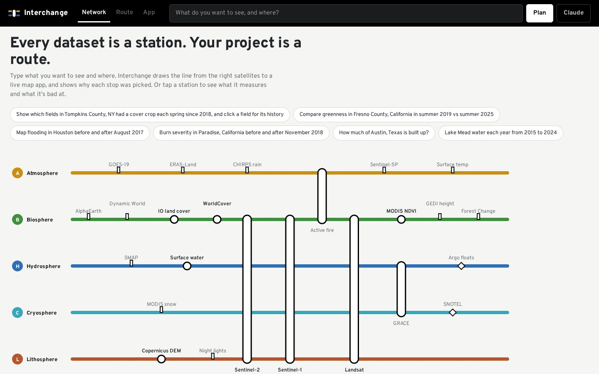
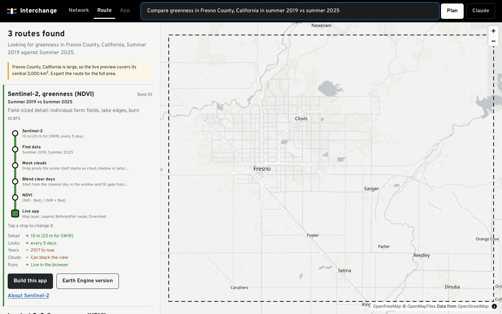
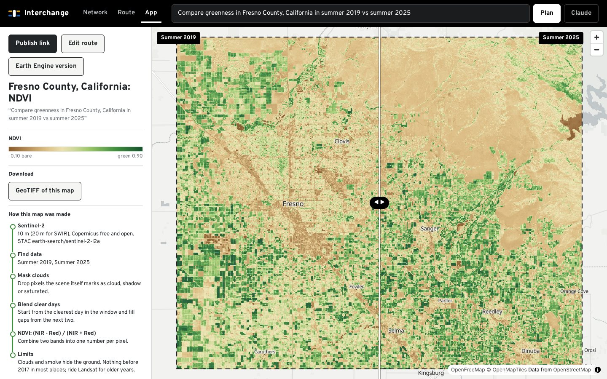
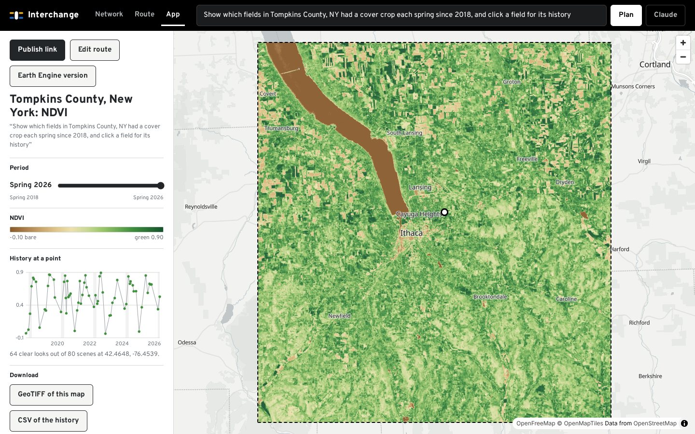

# Interchange

**Type a question about the planet, get a live map app that answers it, and see which satellites and methods it rode to get there.**

Try it: **[shourya0mehta.github.io/interchange](https://shourya0mehta.github.io/interchange/)**. Pick one of the example goals, press Build this app, then Publish link.

Interchange is a prompt-to-app builder for Earth observation. You write one sentence ("compare greenness in Fresno County, California in summer 2019 vs summer 2025"). Interchange draws your project as a route across a transit map of the observing system: a data station, method stops, and an app at the end of the line. Every stop can be inspected and swapped. When the route looks right, it compiles into a map app with a share link that opens for anyone, no login.

Everything runs in the browser on open data. There is no server, no account and no compute bill.

| The network | A route for one sentence |
| --- | --- |
|  |  |
| **Swipe app: Fresno County greenness, summer 2019 vs 2025** | **Click-for-history app: Tompkins County fields since 2018** |
|  |  |

## How it works

```
sentence ─▶ intent ─▶ candidate routes ─▶ type check ─▶ app spec ─▶ live app / share link
             │            │                                │
   rule reader or      network.ts: 24 stations,       runtime: reads COG windows
   Claude (your key)   9 methods, 7 components        straight from open buckets
```

1. **Read the goal.** A rule-based reader pulls out the theme (greenness, floods, burn severity, land cover...), the place, the dates and the app shape (swipe, time slider, click-for-history, region stats). With an Anthropic API key, Claude Haiku does this instead, constrained by a JSON schema to the network's own vocabulary.
2. **Plan routes.** Each theme has candidate stations in order of fit. The planner fits the dates to each station's record (Sentinel-2 can't see 2010, so the route transfers to Landsat), picks methods, and lays out the trade-offs: detail, revisit, years, clouds, and whether it runs live.
3. **Type-check.** A route is a typed program. `scene` flows into `index` and comes out `raster`; a click-for-history chart only accepts a `raster` from a station that changes over time; a swipe needs exactly two windows. Bad routes never reach the app.
4. **Compile.** The route becomes an `AppSpec` small enough to live in the URL (`#app=...`, 500 to 700 characters compressed). Publishing is copying a link.
5. **Run.** The runtime searches STAC catalogs (Earth Search, Planetary Computer), reads only the COG windows it needs at an overview level matched to the screen, masks clouds with each scene's own classification, blends up to three clear days, computes the index, reprojects into a Web Mercator grid and draws it under MapLibre's labels.

## What it can answer today

| Station | Reads | Signals |
| --- | --- | --- |
| Sentinel-2 L2A | Earth Search | true color, NDVI, NDWI, MNDWI, NBR, NDSI, NDMI, NDBI |
| Landsat 5, 8, 9 Collection 2 L2 (Tier 1) | Planetary Computer | same as Sentinel-2, back to 1984 |
| Sentinel-1 RTC | Planetary Computer | radar backscatter (floods through clouds) |
| MODIS 16-day NDVI | Planetary Computer | greenness since 2000 |
| Impact Observatory annual land cover | Planetary Computer | 9 classes, 2017 to 2023 |
| ESA WorldCover | Planetary Computer | 11 classes, 2020 and 2021 |
| JRC Global Surface Water | Planetary Computer | water occurrence 1984 to 2021 |
| Copernicus DEM GLO-30 | Planetary Computer | elevation |

Sixteen more stations (ERA5, CHIRPS, SMAP, GRACE, FIRMS, Sentinel-5P, GOES, Dynamic World, AlphaEarth, GEDI, Hansen forest change, night lights, SNOTEL, Argo...) sit on the network map with dossiers. Routes through them end in an Earth Engine export instead of a live app.

## Measured

- Tompkins County NDVI from Sentinel-2: about 3 seconds for a 768-pixel grid, from STAC search to pixels (Node, same code path as the browser).
- Click-for-history at a farm field, one year of Sentinel-2: 57 scenes searched, 36 clear looks, under 6 seconds.
- Gallery test: 10 of 10 sampled public Earth Engine apps rebuilt from one sentence with no hand edits (`test/gallery.test.ts`).
- Browser smoke test: 12 checks across network, planning, swipe, publish, history chart, land cover stats and a phone layout, zero console errors (`scripts/smoke.mjs`).

## What is not built

- Multi-year composites over large areas in the browser. Heavy routes export to Earth Engine instead; a scheduled GitHub Action build is the planned v2 answer.
- Live previews are capped at about 3,000 km². Bigger places preview their center.
- No accounts, uploads beyond the place name, private data, alerts or classification from examples (AlphaEarth embeddings are v3).
- The rule reader handles plain sentences; looser ones need a Claude key.

## Run it

```bash
npm install
npm run dev            # http://localhost:5173
npm test               # unit tests, planner, gallery test
INTEGRATION=1 npm test # also reads real data from Earth Search and Planetary Computer
npm run build && npx vite preview --port 4173 &
npm run smoke          # headless browser walkthrough with screenshots in shots/
```

## Data and credits

Imagery and products from ESA Copernicus, USGS/NASA Landsat, NASA MODIS, Impact Observatory/Esri, ESA WorldCover, the EC JRC and the Copernicus DEM, read through [Earth Search](https://registry.opendata.aws/sentinel-2-l2a-cogs/) by Element 84 and the [Microsoft Planetary Computer](https://planetarycomputer.microsoft.com/). Basemap by [OpenFreeMap](https://openfreemap.org/) with OpenStreetMap data; geocoding by OpenStreetMap Nominatim with Komoot Photon as a fallback. The observing-system framing comes from Ryan Orbuch's [Natural General Intelligence](https://naturalgeneralintelligence.ai/#observing-system).

MIT license.
